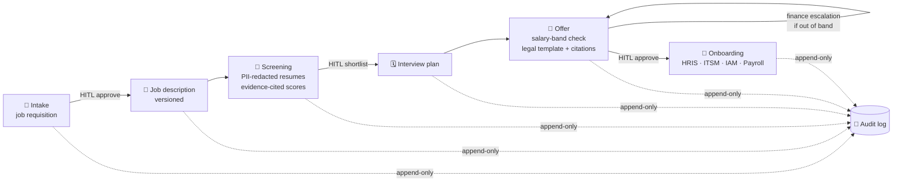

<div align="center">

# 🧑‍💼 HireFlow: Agentic HR Copilot

### An end-to-end hiring workflow with human approvals, audit trails and LLMOps on Azure

*Requisition → job description → screening → interviews → offer → onboarding.<br/>
LangGraph agents do the work; humans approve every important decision.*

<br/>


</div>

> 🚧 **Work in progress.** The domain model and local infrastructure are done. The agent graph, API and integrations are being built next; see the [roadmap](#%EF%B8%8F-roadmap).

---

## 💡 The idea

Hiring is a long, multi-step process with many stakeholders, sensitive data and legal risk. It suits **agentic automation**, but only with **guardrails, human sign-off and a full audit trail**.

HireFlow treats the whole hiring lifecycle as **one LangGraph state machine**:



---

## 🧱 What's built: the state model

[`app/graph/state.py`](app/graph/state.py) defines the single **`HRCopilotState`** that flows through every node. Pydantic v2 validates it, and the LangGraph checkpointer stores it in Postgres between steps.

| Model | Notable design choices |
|---|---|
| `JobRequisition` | Lifecycle enum `DRAFT → APPROVAL_PENDING → APPROVED → ACTIVE → CLOSED` |
| `CandidateProfile` | Raw resume and **redacted** resume live in **separate Azure Blob containers**. Has `pii_redacted` and `injection_flagged` flags, an **uncertainty** level, and a recommendation of `shortlist` / `needs_review` / `reject` |
| `EvidenceRef` | Each score is tied to an **exact resume quote** for one rubric criterion, which makes it explainable |
| `ApprovalToken` | Human-in-the-loop record of **approve / reject / edit**, with approver, timestamp, comments and edited fields |
| `OfferPackage` | `in_band` check, `requires_finance_escalation`, legal template and clause **citations** |
| `OnboardingTask` | Owner, target system (HRIS / ITSM / IAM / Calendar / Email / Payroll), SLA, blockers, ticket ID |
| `AuditEvent` | **Append-only** log of approvals, tool calls, PII redactions, injection flags and node errors |
| Version pins | `graph_version`, `prompt_bundle_version`, `rag_index_version` and `tool_bundle_version` are fixed per run, so every decision can be **reproduced** |

---

## 🐳 Local platform (docker-compose)

One `docker compose up` starts the full stack:

| Service | Image | Role |
|---|---|---|
| `postgres` | `pgvector/pgvector:pg16` | Checkpointer, app data and **vector store** for policy and legal RAG |
| `redis` | `redis:7-alpine` | Cache (256 MB, `allkeys-lru`) |
| `api` | built from `Dockerfile` | FastAPI on `:8000`, **non-root** container user |
| `prometheus` | `prom/prometheus` | Scrapes `api:8000/metrics` every 15 s |
| `grafana` | `grafana/grafana` | Dashboards on `:3000` |

---

## 🗺️ Roadmap

- [x] Typed hiring-lifecycle state with HITL approvals, audit log and version pins
- [x] Containerised platform: Postgres + pgvector, Redis, Prometheus, Grafana
- [x] Azure configuration (Blob Storage, Key Vault, service principal) in `.env.example`
- [ ] `app/graph`: LangGraph nodes and `interrupt()`-based approval gates
- [ ] `app/safety`: PII redaction and prompt-injection screening of resumes
- [ ] `app/rag`: pgvector retrieval over HR policy and legal templates
- [ ] `app/tools`: HRIS / ITSM / IAM / Calendar integrations
- [ ] `app/api`: FastAPI endpoints and `/metrics`
- [ ] `app/observability`: OpenTelemetry traces and `structlog`
- [ ] `app/eval`: MLflow-tracked screening and offer quality evals

---

## 🚀 Run the platform

```bash
git clone https://github.com/nishantrv/Agentic_HR_Copilot_E2E_LangGraph_Azure_LLMOPS.git
cd Agentic_HR_Copilot_E2E_LangGraph_Azure_LLMOPS
cp .env.example .env          # fill in OpenAI + Azure values
docker compose up -d postgres redis prometheus grafana
```

Grafana is at http://localhost:3000 and Prometheus at http://localhost:9090.

---

## 🗂️ Layout

```
app/
├── graph/state.py      ← HRCopilotState and domain models (done)
├── api/  rag/  safety/  tools/  observability/  eval/   (scaffolded)
infra/prometheus.yml
docker-compose.yml · Dockerfile · requirements.txt · .env.example
```

---

## 🧰 Planned stack

**LangGraph** · **LangChain** · **OpenAI** · **FastAPI** · **Pydantic v2** · **PostgreSQL + pgvector** · **SQLAlchemy / Alembic** · **Redis** · **Azure Blob Storage · Key Vault · Identity** · **OpenTelemetry** · **Prometheus · Grafana** · **MLflow** · **structlog** · **tenacity** · **pytest**

---

<div align="center">

Built by **[Nishant](https://github.com/nishantrv)**. ⭐ the repo to follow progress.

</div>
